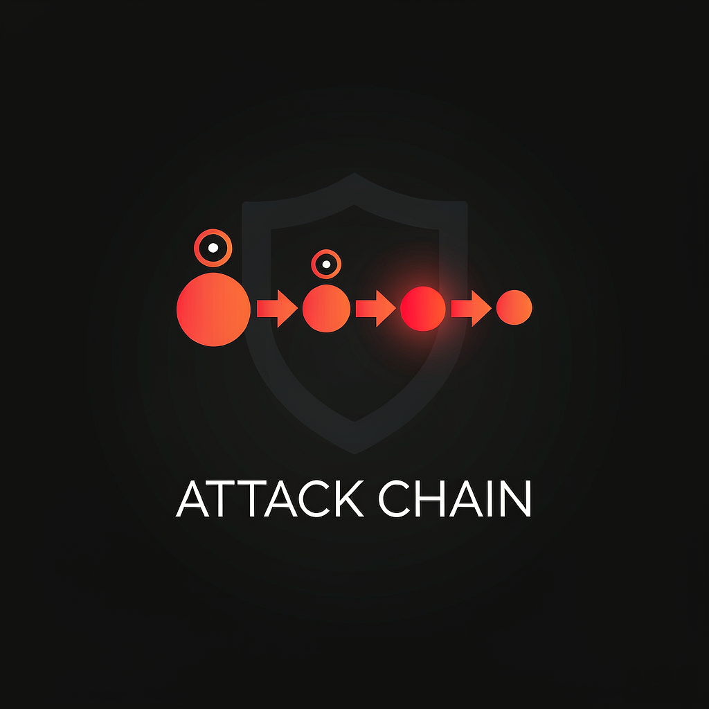

<p align="center"></p>

# attack-chain —— 攻击链路径分析与可视化工具

把一次授权红队演练的攻击链建模成有向图，回答防守方最关心的四个问题：

1. **最短攻击路径**是什么？整链成功概率多高？
2. 有没有**单点故障**（割点）？在哪里设卡收益最大？
3. 入口被封后还有几条**节点不相交的备用路线**？
4. 哪些环节是**检测盲区**（低可检测性动作）？

> ⚠️ 仅用于授权靶场与红蓝复盘。项目不含任何扫描/利用代码，只做图论推演。

## 快速开始

```bash
# 依赖：Python 3.10+，安装依赖
pip install -r requirements.txt

# 对内置的 VulnStack8 示例链做全量分析（出图 + 四类分析 + Markdown 报告）
python -m attackchain --input examples/vulnstack8-chain.yaml --out report --weight balanced

# 无 Graphviz 也能出图 —— 内置纯 Python 分层布局器（svg/png/pdf 三格式）
```

输出到 `report/`：`attack-chain.svg / .png / .dot / .mmd` + `report.md`。

## 常用参数

| 参数 | 说明 |
|---|---|
| `--input` | 攻击链 YAML（节点=战术动作，含成本/失败率/可检测性） |
| `--out` | 输出目录 |
| `--weight` | 路径代价口径：`balanced`（默认）/ `stealth`（隐蔽优先）/ `impact`（影响优先） |
| `--block <节点id>` | 防守模拟：封锁某节点后看链路是否仍可达 |
| `--no-render` / `--no-report` | 只算图不出图 / 不写报告 |
| `--json` | 额外导出机器可读的分析结果 JSON |

## 示例说明

- `examples/vulnstack8-chain.yaml`：红日 VulnStack 8 靶场的简化攻击链（Web 入口 → 域控，13 节点/12 边）。
  示例中 T1110.001 被建模为 Initial Access（口令喷洒作为入口动作），ATT&CK 官方归属为
  Credential Access —— 加载时会提示模型一致性告警，属预期行为，不是 bug。
- `examples/vulnstack7-chain.yaml`：红日 VulnStack 7 三层靶场（外网 Redis → 内网1 双跳板 → 内网2 域控，15 节点/16 边）。
  完整使用示范见 [docs/使用教程-红日7示范.md](docs/使用教程-红日7示范.md)（含实跑输出逐行解读与防守模拟演示）。

## 设计文档

详见 [docs/开发文档.md](docs/开发文档.md)（含本地实测环境结论与实跑记录）。

## 开发与测试

```bash
pip install -r requirements.txt pytest
python -m pytest tests/ -v          # 25 个用例：模型校验 / 图算法 / 防守模拟 / 示例回归
```

测试覆盖 `model`（字段合法性）、`analyze`（四种权重口径、最短路径、SPOF、
卡点排序、备用路径不相交、成功率乘法衰减、防守模拟）、`loader`（YAML 加载与
示例链回归）。CI 在 GitHub Actions 上跑 Python 3.10–3.13 矩阵 + 示例链冒烟。

## 品牌资产

| 文件 | 用途 |
|---|---|
| `logo/attack-chain-logo.png` | 完整 Logo（1024×1024，含项目名） |
| `logo/icon-square.png` | 图形标志方形裁切（520×520） |
| `icon-512.png` / `favicon.ico` | 512 方形图 / 多尺寸图标（16-256，含 ICO 魔数校验） |
