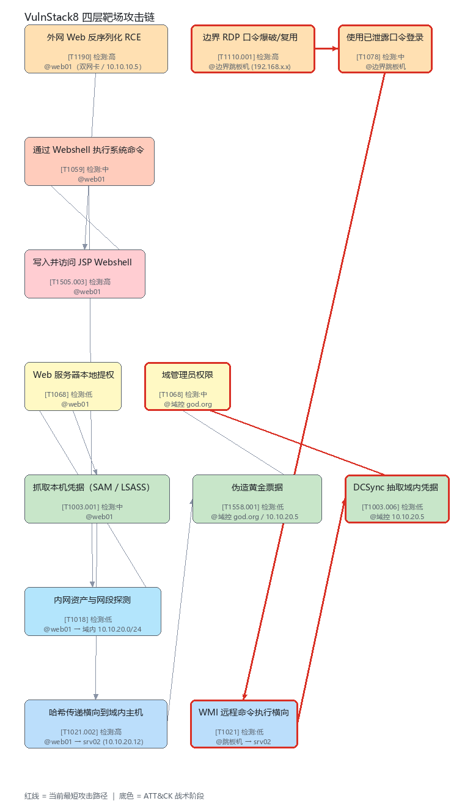

# VulnStack8 四层靶场攻击链 —— 攻击链分析报告

> 本报告由 attack-chain 自动生成，用于授权靶场演练与红蓝复盘。

| 项目 | 内容 |
|---|---|
| 目标环境 | 红日 VulnStack 8（本地 VMware 自建靶场） |
| 场景说明 | Web 服务器双网卡，外网段可直接访问；域内网段只能通过 Web 服务器跳转。 目标是拿到域管理员权限。本文件建模了两条互斥的进攻路线： Web 反序列化打点链 与 边界 RDP 口令复用链。 |
| 分析者 | cypewake |
| 生成时间 | 2026-10-15 15:28 |
| 图规模 | 13 个节点 / 12 条边 |
| 权重口径 | `balanced` |
| ATT&CK 版本 | MITRE ATT&CK Enterprise v14 |

## 一、攻击链图

红线为当前最短攻击路径，节点底色对应 ATT&CK 战术阶段。

## 二、结论摘要

- **最短路径**（4 跳 / 5 个节点）：`边界 RDP 口令爆破/复用` → `使用已泄露口令登录` → `WMI 远程命令执行横向` → `DCSync 抽取域内凭据` → `域管理员权限`
- 对应技术链：`T1110.001` → `T1078` → `T1021` → `T1003.006` → `T1068`
- 该路径综合代价 `6.567`，整链成功概率约 **5.82%**

- **不存在单点故障**：攻击方已具备冗余路径，防守需多点布防。
- **最优设卡点**：`抓取本机凭据（SAM / LSASS）`，覆盖 50% 的入口→目标路径

- **最短路径上的检测盲区 2 处**：`WMI 远程命令执行横向`、`DCSync 抽取域内凭据`（这些环节防守方基本看不见）

## 三、ATT&CK 技术映射

| 节点 | 技术编号 | 技术名称 | 战术 | 检测度 | 建议数据源 |
|---|---|---|---|---|---|
| 外网 Web 反序列化 RCE | `T1190` | Exploit Public-Facing Application | 初始访问 `TA0001` | 高 | WAF 拦截告警：Java 反序列化特征（aced0005）；Web 访问日志中异常 POST 体积与 UA |
| 写入并访问 JSP Webshell | `T1505.003` | Server Software Component: Web Shell | 持久化 `TA0003` | 高 | 主机文件监控（新建 .jsp）；上传/解析目录的文件完整性监控(AIDE) |
| 通过 Webshell 执行系统命令 | `T1059` | Command and Scripting Interpreter | 执行 `TA0002` | 中 | 进程创建审计 4688 / auditd execve；Web 服务进程派生 cmd.exe / /bin/sh 的父… |
| 内网资产与网段探测 | `T1018` | Remote System Discovery | 发现 `TA0007` | 低 | 内网 NTA / 流量镜像（多数靶场与中小企业没有） |
| Web 服务器本地提权 | `T1068` | Exploitation for Privilege Escalation | 权限提升 `TA0004` | 低 | 内核利用较难捕获，建议关注进程令牌提升 4672 |
| 抓取本机凭据（SAM / LSASS） | `T1003.001` | OS Credential Dumping: LSASS Memory | 凭据访问 `TA0006` | 中 | LSASS 句柄访问告警（Sysmon 10 / EDR）；SAM 注册表 hive 导出行为 |
| 哈希传递横向到域内主机 | `T1021.002` | Remote Services: SMB/Windows Admin Shares | 横向移动 `TA0008` | 高 | 4624 Type 3 网络登录 + 异常源主机；SMB 会话异常 + Pass-the-Hash 行为特征 |
| 伪造黄金票据 | `T1558.001` | Golden Ticket | 凭据访问 `TA0006` | 低 | 域控 Kerberos 日志 4769（异常加密类型 RC4）；krbtgt 账户最后修改时间监控（这是根治手段） |
| 边界 RDP 口令爆破/复用 | `T1110.001` | Password Guessing | 初始访问 `TA0001` | 高 | 4625 失败登录风暴告警；设备合规/堡垒机双因子策略 |
| 使用已泄露口令登录 | `T1078` | Valid Accounts | 初始访问 `TA0001` | 中 | 异地/异常时间登录基线；4624 Type 10 的源 IP 归属 |
| WMI 远程命令执行横向 | `T1021` | Remote Services | 横向移动 `TA0008` | 低 | WMI 活动日志 5857/5859（需手动开启）；WinRM/SMB Pipe 行为（Sysmon 17/18） |
| DCSync 抽取域内凭据 | `T1003.006` | OS Credential Dumping: DCSync | 凭据访问 `TA0006` | 低 | 域控 4662 目录服务访问（需配 SACL）；非域控主机向 DC 发起 DSBind 请求的异常行为 |
| 域管理员权限 | `T1068` | Exploitation for Privilege Escalation | 权限提升 `TA0004` | 中 | 4756 域管理员组成员变更；4672 特殊权限登录 |

## 四、最短路径明细

| # | 节点 | 技术编号 | 战术 | 检测度 | 单步失败率 |
|---|---|---|---|---|---|
| 1 | 边界 RDP 口令爆破/复用 | `T1110.001` | Initial Access | 高 | 50% |
| 2 | 使用已泄露口令登录 | `T1078` | Initial Access | 中 | 20% |
| 3 | WMI 远程命令执行横向 | `T1021` | Lateral Movement | 低 | 30% |
| 4 | DCSync 抽取域内凭据 | `T1003.006` | Credential Access | 低 | 30% |
| 5 | 域管理员权限 | `T1068` | Privilege Escalation | 中 | 5% |

> 整链成功概率是所有环节成功概率的连乘积。单看每一步都很稳，串起来往往只剩百分之几 —— 这正是必须准备备用路径的量化理由。

## 五、单点故障分析（SPOF）

✅ 本链路不存在单点故障：任意单个中间节点被打掉后，攻击方仍有可达路径。

## 六、防守卡点排序

按「覆盖了多少条入口→目标路径」排序，覆盖率越高越值得优先设卡：

| 排名 | 节点 | 路径覆盖率 | 技术编号 | 平均致瘫收益 |
|---|---|---|---|---|
| 1 | 抓取本机凭据（SAM / LSASS） | 50% (1/2) | `T1003.001` | impact=4 |
| 2 | DCSync 抽取域内凭据 | 50% (1/2) | `T1003.006` | impact=5 |
| 3 | 通过 Webshell 执行系统命令 | 50% (1/2) | `T1059` | impact=2 |
| 4 | 伪造黄金票据 | 50% (1/2) | `T1558.001` | impact=5 |
| 5 | 内网资产与网段探测 | 50% (1/2) | `T1018` | impact=2 |
| 6 | 哈希传递横向到域内主机 | 50% (1/2) | `T1021.002` | impact=3 |
| 7 | WMI 远程命令执行横向 | 50% (1/2) | `T1021` | impact=3 |
| 8 | Web 服务器本地提权 | 50% (1/2) | `T1068` | impact=4 |
| 9 | 使用已泄露口令登录 | 50% (1/2) | `T1078` | impact=3 |
| 10 | 写入并访问 JSP Webshell | 50% (1/2) | `T1505.003` | impact=3 |

## 七、备用路径校验（两条路径原则）

找到 **2 条节点不相交的路径**，独立性 ✅ 通过：

- 路径 1：`边界 RDP 口令爆破/复用` → `使用已泄露口令登录` → `WMI 远程命令执行横向` → `DCSync 抽取域内凭据` → `域管理员权限`
- 路径 2：`外网 Web 反序列化 RCE` → `写入并访问 JSP Webshell` → `通过 Webshell 执行系统命令` → `内网资产与网段探测` → `Web 服务器本地提权` → `抓取本机凭据（SAM / LSASS）` → `哈希传递横向到域内主机` → `伪造黄金票据` → `域管理员权限`

## 八、检测覆盖面分析

全链路共 **5 个节点**处于防守盲区（detectability=low）：

| 节点 | 技术编号 | 风险 | 建议 |
|---|---|---|---|
| 内网资产与网段探测 | `T1018` | 防守方在此环节缺少有效数据源 | 补充数据源，或接受该环节不可见并在上游/下游设卡 |
| Web 服务器本地提权 | `T1068` | 防守方在此环节缺少有效数据源 | 补充数据源，或接受该环节不可见并在上游/下游设卡 |
| 伪造黄金票据 | `T1558.001` | 防守方在此环节缺少有效数据源 | 补充数据源，或接受该环节不可见并在上游/下游设卡 |
| WMI 远程命令执行横向 | `T1021` | 防守方在此环节缺少有效数据源 | 补充数据源，或接受该环节不可见并在上游/下游设卡 |
| DCSync 抽取域内凭据 | `T1003.006` | 防守方在此环节缺少有效数据源 | 补充数据源，或接受该环节不可见并在上游/下游设卡 |

**最短路径上的盲区**（防守方最该着急的部分）：

- `WMI 远程命令执行横向`（`T1021`）—— 补充数据源，或接受该环节不可见并在上游/下游设卡
- `DCSync 抽取域内凭据`（`T1003.006`）—— 补充数据源，或接受该环节不可见并在上游/下游设卡

## 九、防守阻断模拟

下表回答的是实战问题：**如果我在某点设卡，链路会怎么样？**

| 设卡点 | 封锁后是否可达 | 剩余独立路径 | 结论 |
|---|---|---|---|
| `抓取本机凭据（SAM / LSASS）` | 是 | 1 条 | 仍有完整路径（最短 5 跳） |
| `DCSync 抽取域内凭据` | 是 | 1 条 | 仍有完整路径（最短 9 跳） |
| `通过 Webshell 执行系统命令` | 是 | 1 条 | 仍有完整路径（最短 5 跳） |

## 十、模型一致性检查

| 节点 | 级别 | 问题 |
|---|---|---|
| `rdp-brute` | warning | 战术声明 'Initial Access' 与本地表中 T1110.001 的归属 'Credential Access' 不一致 |

---

**合规说明**：本报告仅记录授权靶场与演练环境下的攻击路径推演，不包含任何针对真实系统的利用代码。
